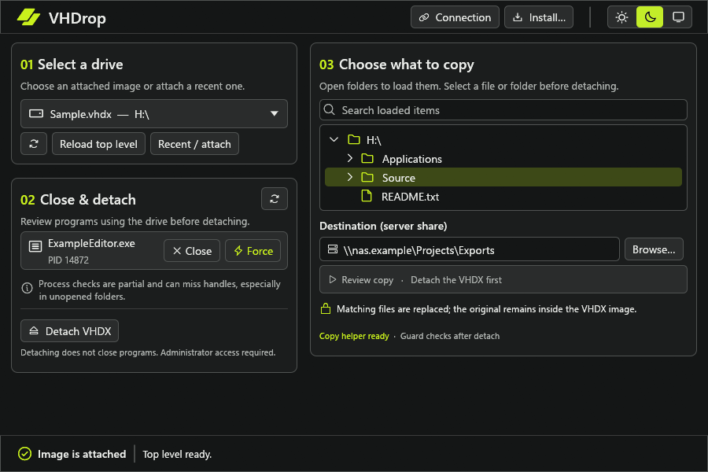
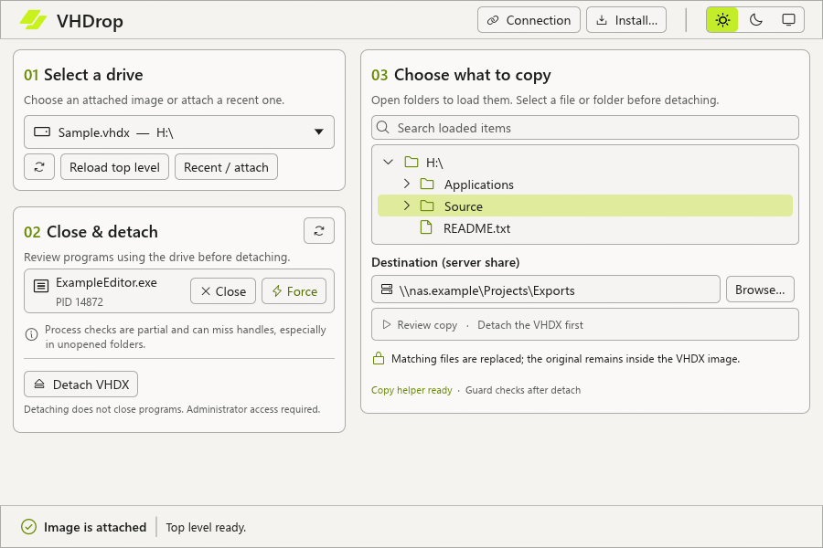
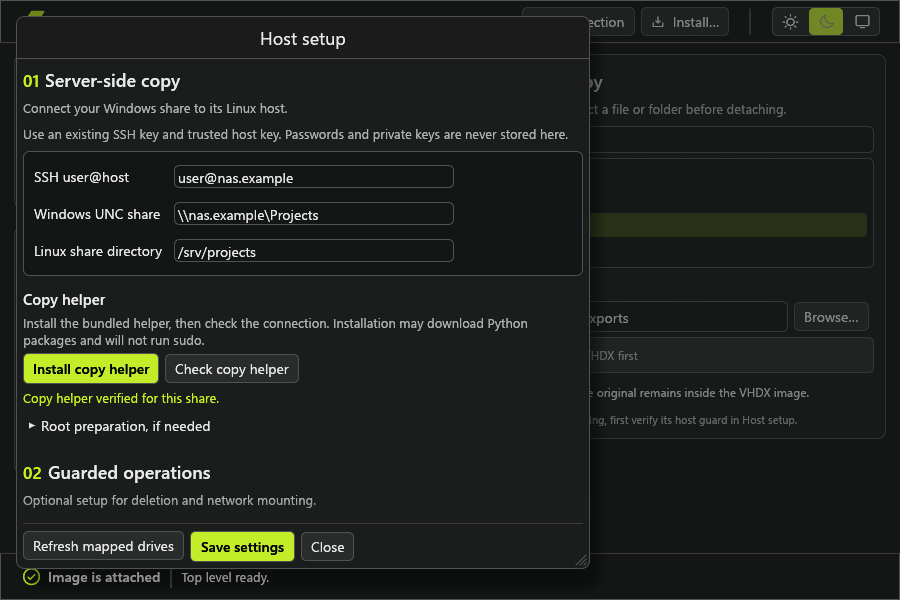

# VHDrop

VHDrop helps you copy files from a VHDX stored on a Linux SMB share. You choose the files in Windows, detach the image, and let the storage host copy the files directly. The data does not need to pass through your Windows PC.

The app can also check for programs using an attached drive, mount and detach images, and delete items from a detached image with an optional host guard.





The connection setup guides you through installing the host helper.



## Download

Download the Windows ZIP from [GitHub Releases](https://github.com/KTheMan/VHDrop/releases/latest). It contains the app and its license notices. Extract it before running `VHDrop.exe`.

## Requirements

- Windows with OpenSSH and an SSH key that can access the storage host.
- A Linux host that can read the same files exposed by the SMB share.
- System Python 3.10 through 3.13, `venv`, pip, and internet access on the host for the copy helper installation.
- Administrator access on Windows to attach and detach disk images.

The copy helper is installed for the SSH user. It requires a canonical, root-owned share directory and a root-owned coordination directory on the share. The app provides a preparation command if the coordination directory is missing.

## Set up the copy helper

Download the Windows ZIP above or build the executable using the [build instructions](#build-and-test).

1. Run `VHDrop.exe` on Windows, or `target/release/vhdrop.exe` if you built it yourself. Choose **Install** if you want a per-user installation, Start menu shortcut, and Explorer actions for VHD and VHDX files.
2. Set up SSH key access and accept the host key using OpenSSH before connecting from the app.
3. Open **Connection**. Enter your SSH address, the Windows UNC share, and the path to the same share on the Linux host. For example, `\\nas.example\share` might map to `/srv/share`.
4. Select **Install copy helper**. If prompted to prepare the coordination directory, review and run the supplied command as a host administrator, then retry the installation.

The app stores connection settings for your Windows user. It does not store SSH keys or passwords. It checks the configured copy helper in the background when it starts and checks the guard when a selected image is detached. The main window shows both statuses. Use **Retry checks** if a host is temporarily unavailable. A previous successful check is not treated as proof that a helper is ready in a new session.

Host setup downloads the copy helper's Python dependencies from PyPI, so it is not fully offline.

## Copy files

1. Select an attached VHDX in VHDrop. The app loads the top level first. Expand folders to load their contents. Search only covers entries that have been loaded.
2. Select the file or folder you want to copy. Choose an existing destination on the configured share.
3. Review the programs shown by the process check and close anything using the drive. Detach the image in the app.
4. Review the Windows and host paths, then start the copy. Keep the image detached on every computer and leave VHDrop open until the copy completes.

The process check is partial and can miss open handles. Each copy uses temporary files to check the source and destination mappings. Both directories need write and delete access. A failed connection can leave a probe file behind.

Matching destination files are replaced. Files that exist only at the destination are kept. A failed copy can leave the destination partially updated. Windows ACLs, alternate data streams, and reparse-point metadata are not preserved.

## Guarded deletion and network mounting

The optional host guard allows VHDrop to delete selected files or folders from a detached VHDX. It also checks configured network images before mounting them from the app. Local image mounting does not require the guard.

The guard supports two configurations:

- Samba on the same Linux host as the storage. Leave the LXC ID blank and enter the same canonical share path for both Linux directories.
- Samba in a Proxmox LXC guest. Enter the LXC ID and the host and guest paths for the share.

Both configurations require guest SMB with an empty password on a trusted network. Authenticated SMB is not currently supported. The guard host SSH account must be root or have noninteractive `sudo`. The installer does not ask for or store a password.

The host needs system Python 3 with `cryptography`, `qemu-img`, `qemu-nbd`, `ntfs-3g`, `ntfs-3g.probe`, `ntfsinfo`, `ntfsls`, `blkid`, `modprobe`, `mount`, `umount`, `fuser`, and `sync`. Samba also needs `testparm` and `stat`. Proxmox installations need `pct` on the host. The app bundles the guard and its pinned SMB dependency wheels.

To enable the guard, open **Connection**, expand **Configure host write guard**, and enter the host and share details. Review and confirm **Install bundled guard**. The app checks the guard for the selected image after detaching it and again after a successful operation. It does not trust a previous session's verification. You can retry the check if it fails.

Right-click a loaded file or folder to delete it. Review the target and type `DELETE` at the second confirmation. Folder deletion is recursive and permanent. There is no Recycle Bin, and deleting files does not necessarily shrink the VHDX.

The guard checks its configuration, installed files, share mapping, SMB lock, operation markers, and NTFS state. It rejects unresolved markers, dirty or hibernated images, and unsupported parent chains. It cannot stop local programs that ignore its locks or eliminate every race after an SMB session is lost. Other mounting tools can bypass the app's checks. Keep backups and do not use the image from another computer while VHDrop is working.

If cleanup reports a safe hold or unresolved marker, keep the image detached and inspect the host before retrying. A failed recursive deletion can be partial.

### Existing guard installations

The guard lives at `/opt/vhdx-handoff-v1` and uses configuration at `/etc/vhdx-handoff-v1`. The installer does not overwrite existing files. If the guard is already installed, let the app check it instead of reinstalling it.

Some earlier builds used the same paths with different helper versions. To upgrade one of those installations, first detach every image, stop all operations, and inspect the coordination directory for active or unresolved markers. Back up and review the old installation and configuration before a host administrator removes the old versioned directories. Never remove markers to force an upgrade.

## Configuration

Connection settings are stored in `%APPDATA%\VHDX Handoff\connections.json`. The old directory name is retained so existing users keep their settings. Recent images and the theme preference are stored per user. Do not commit settings, host configurations, keys, logs, or screenshots that contain private paths.

## Build and test

The Windows app requires Rust stable 1.92 or newer and a Windows linker. Building also requires access to crates.io and the pinned Ouroboros UI Git revision.

```powershell
cargo test --locked
cargo build --release --locked
```

The executable is created at `target/release/vhdrop.exe`. To run the host helper tests on Linux with Python 3:

```sh
python3 -m unittest discover -s server -p 'test_*.py'
```

Some host tests require isolated root-owned fixtures and may be skipped without them.

## License

VHDrop is licensed under LGPL-3.0-or-later. See [LICENSE](LICENSE) and [LICENSE-GPL-3.0](LICENSE-GPL-3.0).

The copy helper separately installs `dissect.target`, which is AGPL-licensed. Other dependencies have their own licenses. See [THIRD_PARTY.md](THIRD_PARTY.md) and [THIRD_PARTY_LICENSES](THIRD_PARTY_LICENSES/README.md).
